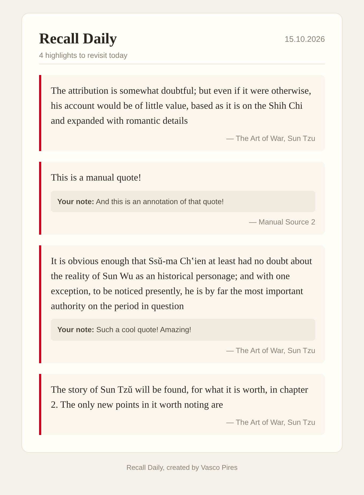
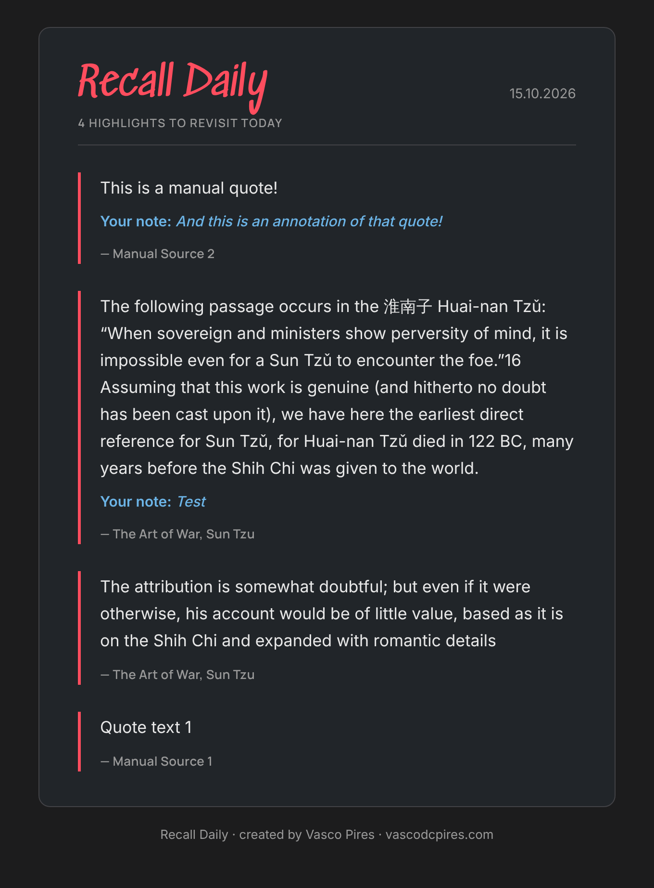
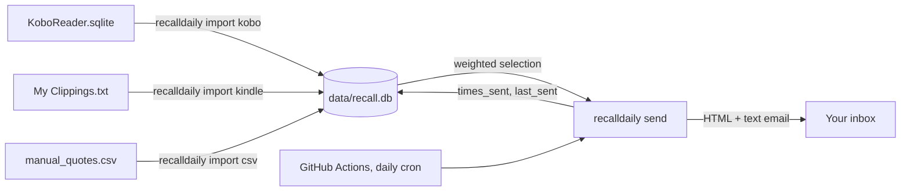

# Recall Daily

[](https://github.com/VascoPires/RecallDaily/actions/workflows/ci.yml)


> Just having it all in your head is not enough. A highlight you never see again is a highlight you forget.

**Recall Daily** emails you a handful of your own book highlights every morning. It's a free, self-hosted alternative to [Readwise](https://readwise.io): it imports highlights from a Kobo or Kindle e-reader (or a CSV), picks a few you haven't seen in a while, and sends them as a clean email. It runs on GitHub Actions, so there's no server to maintain and no cost.

<p align="center">
  
  
</p>

## Features

- **Kobo, Kindle and CSV imports.** Reads `KoboReader.sqlite` and Kindle's `My Clippings.txt` directly, keeping your notes attached to their highlights. Re-importing is safe: only new highlights are added.
- **Smarter than random.** Highlights are weighted by how long since you last saw them and how often they've been sent, with a cooldown so the same quote doesn't come back next week (details below).
- **A good-looking email.** Light and dark mode, a mobile layout and a plain-text fallback.
- **Zero dependencies.** Only the Python standard library: `sqlite3`, `smtplib`, `tomllib`, `argparse`.
- **Private by design.** Only highlight text goes into the repo, never your e-reader's account data.

## How it works



1. You import highlights **on your own computer** into `data/recall.db`, a small SQLite library, and push it.
2. Every morning a GitHub Actions workflow picks today's highlights, emails them, and commits the updated review history back to the repo.

### Choosing highlights

Picking at random means some quotes keep coming back while others never appear. Instead, each highlight gets a weight:

```
weight = (1 + days since last sent) / (1 + times sent)
```

Highlights sent within the last `cooldown_days` (14 by default) are held back, and the rest are sampled in proportion to their weight using the [Efraimidis–Spirakis](https://en.wikipedia.org/wiki/Reservoir_sampling#Algorithm_A-Res) method for weighted sampling without replacement. New highlights count as 90 days unseen, so fresh imports show up soon without crowding out older ones. See [`selection.py`](src/recalldaily/selection.py).

## Setup

### 1. Fork and install

```bash
git clone https://github.com/<you>/RecallDaily.git
cd RecallDaily
python -m pip install -e ".[dev]"   # Python 3.11+
```

### 2. Import your highlights

```bash
# Kobo: connect the e-reader over USB; the database is in the hidden .kobo folder
recalldaily import kobo /Volumes/KOBOeReader/.kobo/KoboReader.sqlite

# Kindle: connect over USB
recalldaily import kindle "/Volumes/Kindle/documents/My Clippings.txt"

# Your own quotes: columns Text, Source, plus optional Author and Annotation
recalldaily import csv manual_quotes.csv

recalldaily stats                        # what's in the library
recalldaily send --dry-run preview.html  # open preview.html in a browser
```

> **Never commit `KoboReader.sqlite`.** Besides your highlights it contains your Kobo account email, device ID and login tokens. `.gitignore` already excludes it. Import it locally and commit only `data/recall.db`.

Commit and push the library:

```bash
git add data/recall.db && git commit -m "Import highlights" && git push
```

### 3. Configure email

Create a [Gmail app password](https://myaccount.google.com/apppasswords) (2-step verification required), then add these **repository secrets** under *Settings → Secrets and variables → Actions*:

| Secret | Value |
| --- | --- |
| `MAIL_USER` | Your Gmail address |
| `MAIL_PASSWORD` | The 16-character app password |
| `DAILY_REPORT_TO` | Recipient address(es), comma-separated |
| `DAILY_REPORT_FROM` | *(optional)* Sender address, defaults to `MAIL_USER` |

Other providers work too: set `smtp_host` and `smtp_port` in [`recalldaily.toml`](recalldaily.toml).

### 4. Turn it on

On the **Actions** tab, enable workflows, open **Daily email** and click **Run workflow** to send a test. Then uncomment the `schedule` lines in [`.github/workflows/daily.yml`](.github/workflows/daily.yml) to send it every day at 07:00 UTC (adjust the `cron` time to taste).

To add a quote later, edit `manual_quotes.csv` directly on GitHub; it's synced before each send.

## Configuration

All settings in [`recalldaily.toml`](recalldaily.toml) are optional:

| Setting | Default | |
| --- | --- | --- |
| `num_quotes` | `4` | Highlights per email |
| `cooldown_days` | `14` | Minimum days before a highlight is resent |
| `library` | `data/recall.db` | Path to the library |
| `smtp_host` / `smtp_port` | `smtp.gmail.com` / `465` | Port 465 uses SSL; others use STARTTLS |
| `subject` | `Your Recall Daily – {date}` | Email subject |
| `date_format` | `%d.%m.%Y` | [strftime](https://strftime.org) format |
| `footer` | `Recall Daily` | Footer text |

## Development

```bash
pytest              # tests
ruff check . && ruff format --check .
```

```
src/recalldaily/
├── cli.py          # import / send / stats commands
├── sources/        # kobo.py, kindle.py, csv_file.py importers
├── store.py        # SQLite library and review history
├── selection.py    # weighted, cooldown-aware selection
├── render.py       # HTML + plain-text email
├── mailer.py       # SMTP
└── templates/email.html
```

CI runs lint and tests on Python 3.11–3.13 and uploads a rendered preview email as a build artifact.

## Ideas

- Apple Books and Readwise CSV importers
- A static highlights archive on GitHub Pages
- "On this day" highlights from a year ago

## Acknowledgements

The GitHub Actions approach was inspired by:

1. Furrer, David (2020). [How to send emails with GitHub Actions and Python](https://github.com/davidfurrer/send_email_github_actions)
2. Fayock, Colby (2021). [Daily cron to send emails with GitHub Actions & Gmail](https://github.com/colbyfayock/my-daily-report)
3. Loeber, Patrick (2022). [Schedule a Python script with GitHub Actions](https://github.com/patrickloeber/python-github-action-template)

## License

[MIT](LICENSE)
